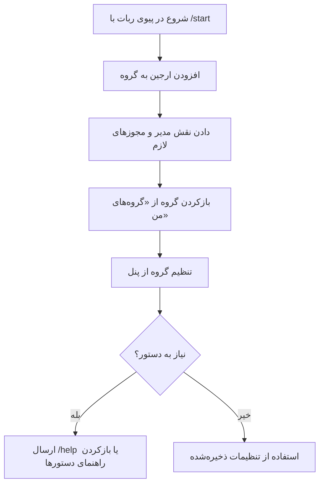
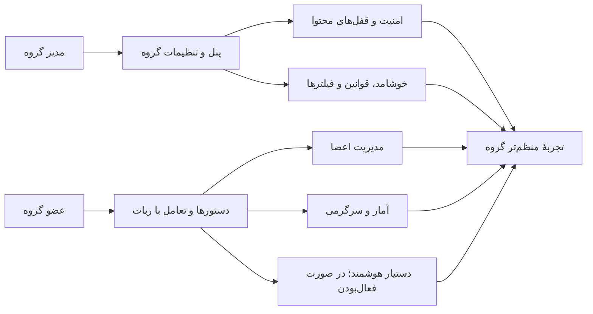
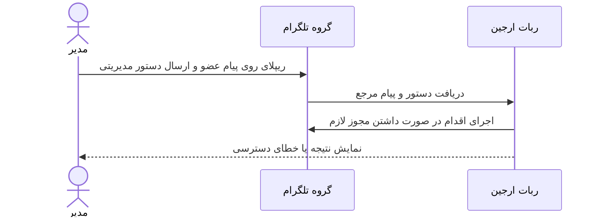

  
  <h1>Orgin | ارجین</h1>
  
<strong>مدیریت گروه تلگرام؛ از نظم و امنیت تا رشد گروه و هوش مصنوعی</strong>

  

    <a href="https://t.me/orginv1bot">ورود به ربات</a> ·
    <a href="https://t.me/orginsupport">پشتیبانی</a> ·
    <a href="https://t.me/orginchanel">کانال رسمی</a> ·
    <a href="https://orginlabs.github.io/orgin-bot-documentation/">وب‌سایت راهنما</a>
  

  
  
  
  
  
  

> ارجین یک ربات تلگرام برای مدیریت اعضا، کنترل محتوا، مقابله با اسپم، خوشامدگویی، رشد گروه، آمار و دستیار هوشمند است. این مخزن راهنمای استفاده و مشارکت در مستندات ارجین است؛ **سورس‌کد خود ربات در این مخزن قرار ندارد.**

## شروع در یک دقیقه

1. در پیوی [@orginv1bot](https://t.me/orginv1bot) دستور `/start` را بفرست.
2. گزینهٔ «افزودن به گروه» را انتخاب کن و گروه را اضافه کن.
3. ربات را مدیر کن و دسترسی‌های لازم برای کارهایی مثل حذف پیام و محدودکردن اعضا را بده.
4. از پیوی وارد «گروه‌های من» شو و گروه را برای بازکردن پنل انتخاب کن.
5. برای راهنمای دستورها `/help` را بفرست؛ برای بیشتر کارهای مدیریتی می‌توانی روی پیام عضو ریپلای کنی.

<strong>نقشهٔ تصویری راه‌اندازی</strong>

## چه کارهایی انجام می‌دهد؟

| حوزه | نمونه قابلیت‌ها | راهنما |
|:---|:---|:---|
| مدیریت اعضا | بن و رفع بن، اخراج، سکوت، اخطار، پین و حذف پیام | [مدیریت اعضا](docs/04-moderation.md) |
| امنیت گروه | ضداسپم، ضدفلود، ضدتبچی، کپچا، حالت شب و گزارش تخلف | [امنیت گروه](docs/13-anti-spam-security.md) |
| قفل محتوا | کنترل لینک، رسانه، فایل، فوروارد، زبان‌ها و انواع پیام | [قفل‌های محتوا](docs/02-locks.md) |
| پیام‌ها | خوشامد و خداحافظی، قوانین، فیلتر کلمات و پاسخ خودکار | [پیام‌ها و قوانین](docs/09-welcome-goodbye-rules.md) |
| رشد گروه | دعوت اجباری با سکوت، لینک دعوت و رتبهٔ دعوت‌کنندگان | [رشد گروه](docs/08-force-add-fsub-captcha.md) |
| هوش مصنوعی | گفت‌وگو در پیوی و گروه، حافظه و راهنمای پنل در صورت فعال‌بودن | [چت‌بات هوشمند](docs/10-orgin-ai.md) |
| آمار و سرگرمی | آمار گروه، اعضای فعال، رتبه، جوک، فال، تاس و بازی | [آمار و سرگرمی](docs/11-fun-games-stats.md) |
| Premium | تیکت، پشتیبان‌گیری و برخی قابلیت‌ها و سهمیه‌های بیشتر | [رایگان و Premium](docs/12-premium.md) |

جزئیات هر قابلیت، محدودیت نقش‌ها و نمونه‌دستورها در [راهنمای کامل](docs/01-navigation-sitemap.md) و [مرجع همهٔ دستورها](docs/14-commands-reference.md) آمده است. دسترسی‌ها ممکن است به نقش کاربر، مجوزهای تلگرام، پلن و فعال‌بودن سرویس وابسته باشند.

## یک نگاه به شیوهٔ کار

این نمودار فقط مسیرهای کاربری مستندشده را نشان می‌دهد و ادعایی دربارهٔ اجزای داخلی یا معماری سرور ربات ندارد.

### نمونهٔ توالی اجرای دستور

این نمودار مفهومی است: نتیجهٔ عملیات مدیریتی به دسترسی ربات در تلگرام وابسته است.

## چند دستور پرکاربرد

| دستور | کاربرد |
|:---|:---|
| `/start` و `/help` | شروع کار و دیدن راهنما |
| `بن`، `سکوت`، `اخطار` | مدیریت عضو؛ معمولاً با ریپلای روی پیام او |
| `قفل لینک` / `بازکردن لینک` | بستن یا آزادکردن لینک‌ها |
| `وضعیت قفل ها` | دیدن وضعیت قفل‌ها |
| `تنظیم خوشامد`، `تنظیم قوانین` | مدیریت پیام‌ها و قوانین گروه |
| `وضعیت اد من` و `لینک` | وضعیت دعوت‌ها و بازکردن منوی لینک دعوت |
| `ارجین [متن]` | گفت‌وگو با دستیار در گروه، در صورت فعال‌بودن |

[فهرست کامل دستورها، شامل معادل‌ها و محدودیت‌ها](docs/14-commands-reference.md)

## اشتراک و پاداش دعوت

نسخهٔ رایگان ابزارهای اصلی مدیریت گروه را دارد. طبق راهنمای فعلی، قیمت‌های پیش‌فرض Premium یک‌ماهه **۱۵۰**، سه‌ماهه **۴۰۰** و دوازده‌ماهه **۱۴۰۰ Telegram Stars** است. قیمت نهایی و پلن‌های در دسترس را پیش از خرید داخل پیوی ربات بررسی کن؛ ممکن است تغییر کنند. برای روش دعوت و پاداش، [راهنمای Premium](docs/12-premium.md) را ببین.

## فهرست مستندات

- [شروع سریع](docs/00-getting-started.md) · [نقشهٔ راهنما](docs/01-navigation-sitemap.md)
- [قفل‌ها](docs/02-locks.md) · [قابلیت‌های تکمیلی](docs/03-new-features.md)
- [مدیریت اعضا](docs/04-moderation.md) · [ابزارهای مدیریتی](docs/05-clean-tools.md)
- [فیلتر و پاسخ خودکار](docs/06-filter-autoreply.md) · [نقش‌ها](docs/07-roles-permissions.md)
- [رشد گروه و کنترل ورود](docs/08-force-add-fsub-captcha.md) · [خوشامد و قوانین](docs/09-welcome-goodbye-rules.md)
- [هوش مصنوعی](docs/10-orgin-ai.md) · [آمار و سرگرمی](docs/11-fun-games-stats.md)
- [Premium](docs/12-premium.md) · [امنیت](docs/13-anti-spam-security.md) · [مرجع دستورها](docs/14-commands-reference.md)
- [پرسش‌های متداول](FAQ.md) · [تاریخچهٔ تغییرات](CHANGELOG.md)

## آمار مخزن و زبان‌ها

کارت‌های زیر به‌صورت زنده از سرویس [GitHub Readme Stats](https://github.com/anuraghazra/github-readme-stats) بارگذاری می‌شوند؛ ممکن است به‌خاطر محدودیت سرویس یا وضعیت دسترسی گاهی نمایش داده نشوند. کارت آمار، فعالیت عمومی حساب `orginlabs` را نشان می‌دهد و کارت زبان‌ها نمای کلی مخزن‌های عمومی آن حساب را، نه لزوماً فقط فایل‌های همین راهنما.

  

  
  

## انتشار نسخه‌ها

نسخه‌های مستندات از مسیر [GitHub Releases](https://github.com/orginlabs/orgin-bot-documentation/releases) منتشر می‌شوند. برای ساخت انتشار، تغییرات را در `CHANGELOG.md` ثبت و یک تگ نسخه مانند `v1.0.0` روی commit آماده‌شده ایجاد کنید؛ GitHub Actions با آن تگ، Release و یادداشت‌های انتشار را می‌سازد. هیچ نسخه‌ای صرفاً با تغییر README منتشر نمی‌شود.

## مشارکت و گفت‌وگو

- پرسش عمومی و راهنمایی: [GitHub Discussions](https://github.com/orginlabs/orgin-bot-documentation/discussions)
- گزارش باگ یا پیشنهاد: [ثبت Issue](https://github.com/orginlabs/orgin-bot-documentation/issues/new/choose)
- راهنمای ارسال تغییر: [CONTRIBUTING.md](CONTRIBUTING.md) · [قوانین رفتار](CODE_OF_CONDUCT.md)
- گزارش آسیب‌پذیری: فقط به‌صورت خصوصی از [Security Advisories](https://github.com/orginlabs/orgin-bot-documentation/security/advisories/new)؛ جزئیات در [SECURITY.md](SECURITY.md)
- حمایت از پروژه: [@newmovie_org](https://t.me/newmovie_org)

### مشارکت‌کنندگان

سپاس از همهٔ کسانی که در بهبود این راهنما نقش داشته‌اند. فهرست زنده از مشارکت‌کنندگان GitHub ساخته می‌شود و با مشارکت‌های جدید به‌روز خواهد شد.

## چارچوب‌های مخزن

این پروژه از GitHub Issues و Pull Requests برای بهبود مستندات استفاده می‌کند. بررسی خودکار روی تغییرات اجرا می‌شود؛ راهنمای ساختار، امنیت و انتشار در فایل‌های زیر است:

[راهنمای مشارکت](CONTRIBUTING.md) · [سیاست امنیتی](SECURITY.md) · [Code of Conduct](CODE_OF_CONDUCT.md) · [الگوی Pull Request](.github/pull_request_template.md) · [تاریخچهٔ تغییرات](CHANGELOG.md) · [انتشارها](https://github.com/orginlabs/orgin-bot-documentation/releases)

  Orgin | گروهت را امن‌تر، مرتب‌تر و هوشمندتر مدیریت کن

